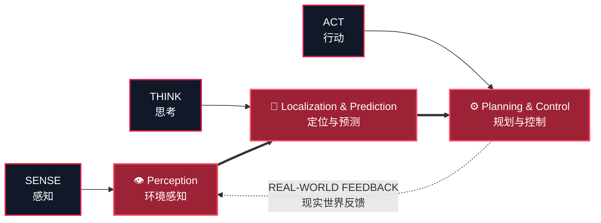

<div align="center">

# ARES ALGORITHM

### `PERCEIVE · DECIDE · CONTROL`

**南方科技大学 ARES 机器人社算法组**<b
**ARES Robotics Algorithm Team · SUSTech**


> **让机器看见，让决策发生，让每一行代码在真实世界落地。**
> **We give robots eyes, intelligence, and the courage to act.**

</div>

---

## 我们是谁 · WHO WE ARE

我们是来自 **南方科技大学（SUSTech）ARES 机器人社** 的算法组。

这里没有停留在屏幕里的算法。我们把数学、代码与工程装进机器人：从相机、雷达捕获数据，到系统锁定目标、理解战场、规划行动，再到控制指令抵达执行机构——**ARES 打通感知、决策与控制的完整链路。**

We are the algorithm team of the **ARES Robotics Club at Southern University of Science and Technology (SUSTech)**.

Our algorithms do not end at a benchmark. We turn mathematics and code into machines that can see, reason, and move. From the first photon hitting the camera to the final command reaching the actuators, **ARES builds the full loop from perception to decision and control.**



## 我们在做什么 · WHAT WE BUILD

| 方向 / Track | 我们的战场 / Our Work |
|:--|:--|
| 👁️ **机器人视觉 / Robot Vision** | 目标检测、识别与跟踪，让机器人稳定看见高速变化的世界。<br>Detection, recognition, and tracking for fast-changing environments. |
| 📍 **定位与建图 / Localization & Mapping** | 融合多源传感器信息，在不确定环境中建立可靠的空间认知。<br>Multi-sensor fusion for robust spatial awareness under uncertainty. |
| 🧠 **预测与决策 / Prediction & Decision** | 从局势理解到行为选择，让机器人不只响应，更能预判。<br>From scene understanding to action selection—reacting fast and anticipating faster. |
| 🧭 **规划与控制 / Planning & Control** | 把高层策略变成快速、精确、可执行的运动。<br>Turning high-level strategy into fast, precise, executable motion. |
| 🤖 **机器学习 / Machine Learning** | 从数据构建、模型训练到推理优化，让机器人从经验中学习并持续进化。<br>From data and training to optimized inference, enabling robots to learn from experience and keep evolving. |

## ARES 的锋芒 · THE ARES EDGE

- **闭环思维 / Full-stack autonomy** — 不孤立优化单个模块，用整机表现定义算法价值。<br>
  We optimize the robot as a system, not a collection of disconnected models.

- **实机为王 / Built for reality** — 延迟、抖动、光照、算力与通信限制，都是算法必须正面击败的对手。<br>
  Latency, noise, lighting, compute, and communication limits are part of the problem—not excuses.

- **快速进化 / Relentless iteration** — 数据、仿真、测试、复盘形成闭环，让每一次部署都比上一次更强。<br>
  Data, simulation, testing, and review form a loop that makes every deployment stronger.

- **传承与开源 / Knowledge compounds** — 沉淀工具、文档和训练体系，让个人突破成为团队的长期能力。<br>
  We turn individual breakthroughs into reusable tools, documentation, and team capability.

- **跨域协同 / One robot, one team** — 与机械、电控并肩工作，因为真正强大的机器人从来不是单点胜利。<br>
  We work shoulder to shoulder with mechanical and embedded teams—great robots are won together.

## 我们相信 · OUR CODE

```cpp
while (challenge.exists()) {
    observe();
    reason();
    build();
    deploy();
    become_stronger();
}
```

我们追求的不只是更高的指标，而是**在真实约束下依然可靠的智能**；不只是跑通一次，而是可复现、可维护、可进化；不只是写出代码，而是让机器人在关键时刻做出正确动作。

We pursue more than higher metrics: **intelligence that remains reliable under real constraints**. Not a one-off demo, but systems that are reproducible, maintainable, and always evolving. Not code for code's sake, but code that makes the right move when it matters.

<div align="center">

## 加入战场 · ENTER THE ARENA

如果你对计算机视觉、机器人、人工智能或自动化系统充满野心，
如果你想让自己的代码冲出屏幕、驱动真正的机器——

**欢迎来到 ARES。下一次进化，由你提交。**

If you are ambitious about computer vision, robotics, AI, or autonomous systems—
if you want your code to leave the screen and command a real machine—

**Welcome to ARES. The next evolution starts with your commit.**

### 📡 招新群 / RECRUITMENT

**QQ 群：`1078223725`**

> 仅面向南方科技大学在校学生。
> Open exclusively to current SUSTech students.

---

### `WE DON'T JUST RUN CODE. WE RUN ROBOTS.`

<sub>Made with ⚡ by the ARES Algorithm Team @ SUSTech</sub>

</div>
